# Bidora: real-time online auction marketplace

A complete multi-vendor auction platform: live bidding with anti-sniping, a mandatory buyer deposit and wallet, a warehouse-inspection workflow with same-day seller payouts, and a full admin control panel with charts.

**Live demo: [bidora-auction.150-230-43-127.sslip.io](https://bidora-auction.150-230-43-127.sslip.io)**

| Role | E-mail | Password |
|---|---|---|
| Buyer | `buyer@bidora.demo` | `demo1234` |
| Seller | `seller@bidora.demo` | `demo1234` |
| Admin | `admin@bidora.demo` | `demo1234` |

The login page has one-click buttons for all three. The demo uses made-up members and money. It resets every night and a few made-up bidders keep the auctions moving, so open an auction page and watch the price change live.

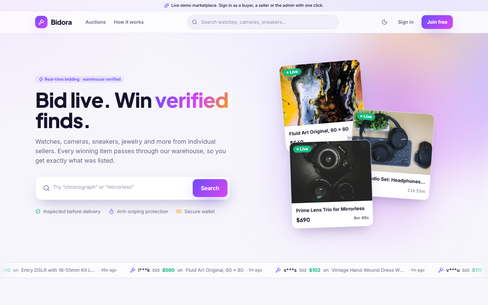

## What it does

**Buyers**
- Free registration with e-mail verification
- Wallet with a mandatory security deposit (the minimum is set by the admin). Bidding unlocks automatically once the deposit is confirmed
- Real-time bidding: live price, bid history and countdown, quick-bid buttons, outbid alerts
- Anti-sniping: a bid in the last minutes extends the auction (window and extension are configurable)
- Watchlist, notifications, order tracking from payment to delivery, and a support conversation if something goes wrong

**Individual sellers**
- Anyone can sell. No company papers or business verification
- Listings with up to six photos, reserve price, bid increment and a duration chosen from the admin's list (3, 5, 7 or 14 days by default)
- Every listing is reviewed by an admin before it becomes visible
- Dashboard with earnings chart, shipping instructions, payout history

**The money flow**
1. The auction ends and the winner is picked automatically.
2. The winner must pay the full price from the wallet within 3 days.
3. Miss the deadline: the deposit is forfeited and bidding is blocked for 15 days. Both rules are enforced by the scheduler and lift automatically.
4. After payment the seller receives warehouse shipping instructions. Sellers never ship to buyers.
5. The warehouse receives the parcel, inspects it and records a condition report.
6. If it passes, the seller's payout is released the same day. If it fails, the buyer is refunded in full.
7. The marketplace packs the item and ships it to the buyer with tracking.

Buyers and sellers never see each other's personal details. All complaints and disputes go through the admin.

**Admin panel** (18 sections)
- Dashboard with sales, revenue, bidding activity, order pipeline, conversion funnel, cash flow, top sellers and live activity
- Review queue, all auctions, live bid monitor with rapid-bidding flags, categories
- Users, account restrictions (automatic and manual)
- Deposits to approve, seller payouts, refunds, a full financial ledger, financial reports with CSV export
- Orders and shipping, a warehouse board (receive, inspect, pack, ship), disputes with a private conversation per party
- Rules and settings (deposit, commission, deadlines, restriction length, anti-sniping, durations, auto payout), editable e-mail templates, activity log

## Screenshots

| | |
|---|---|
| 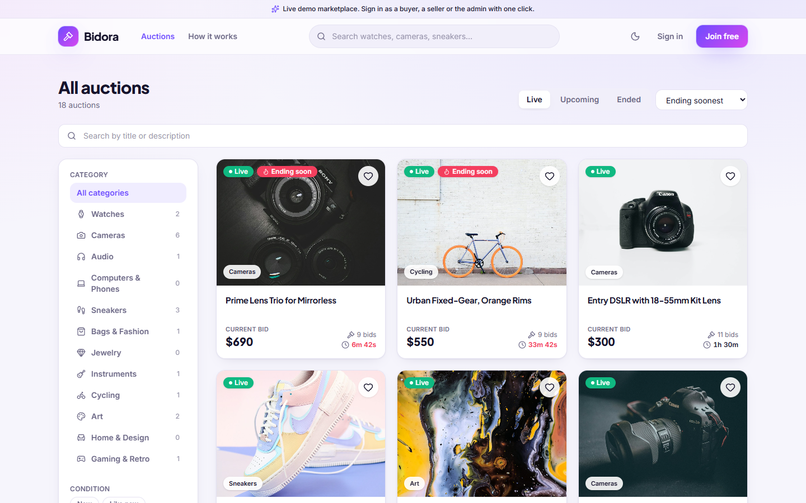 | 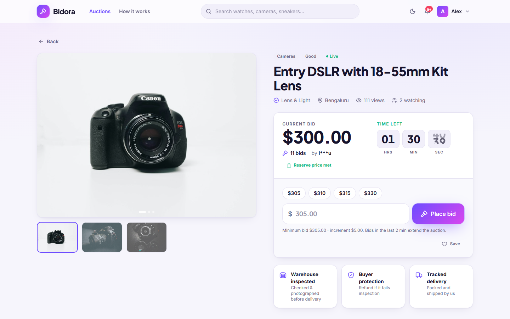 |
| 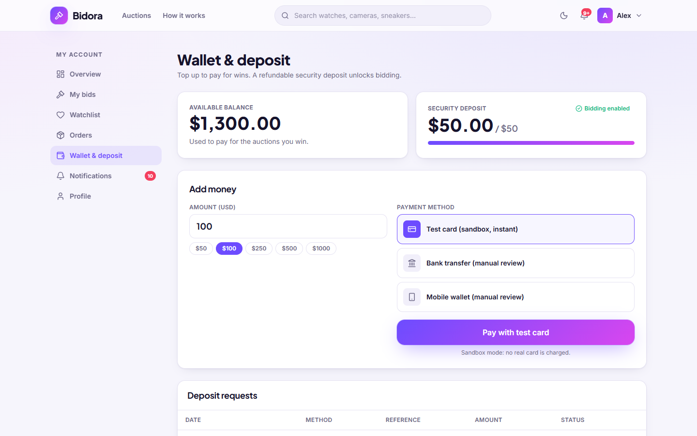 | 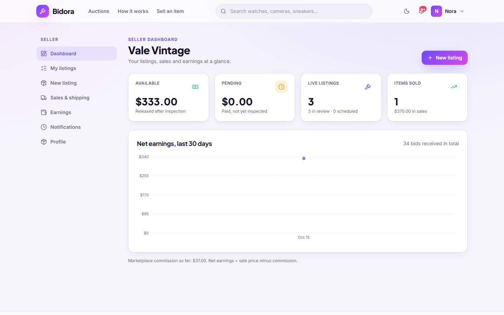 |
| 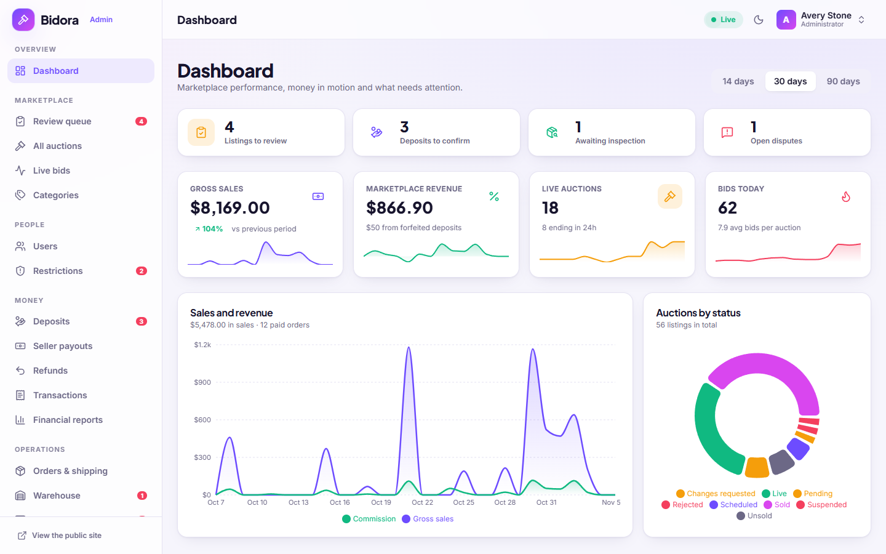 | 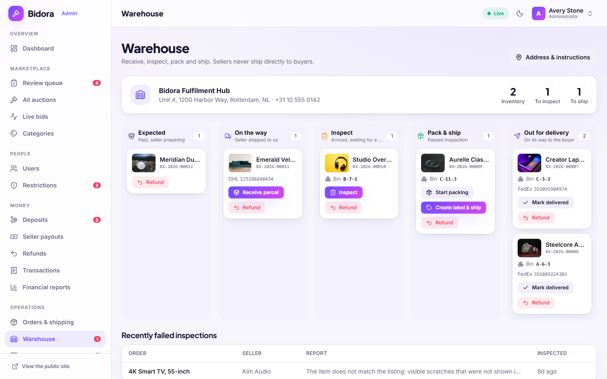 |
| 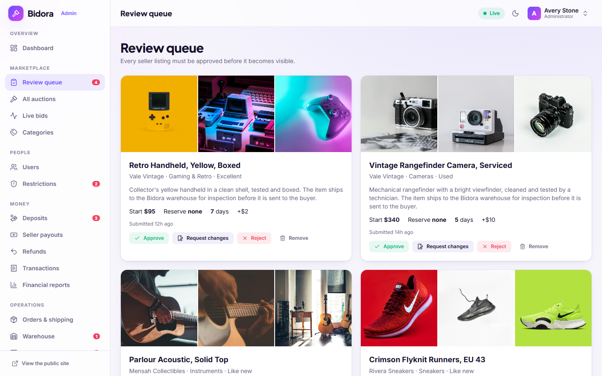 | 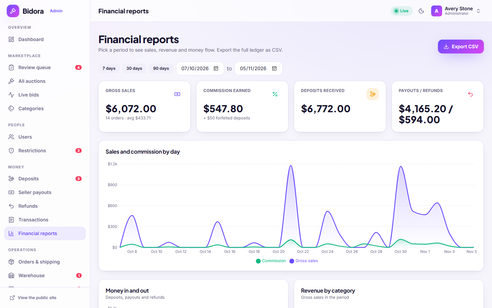 |
| 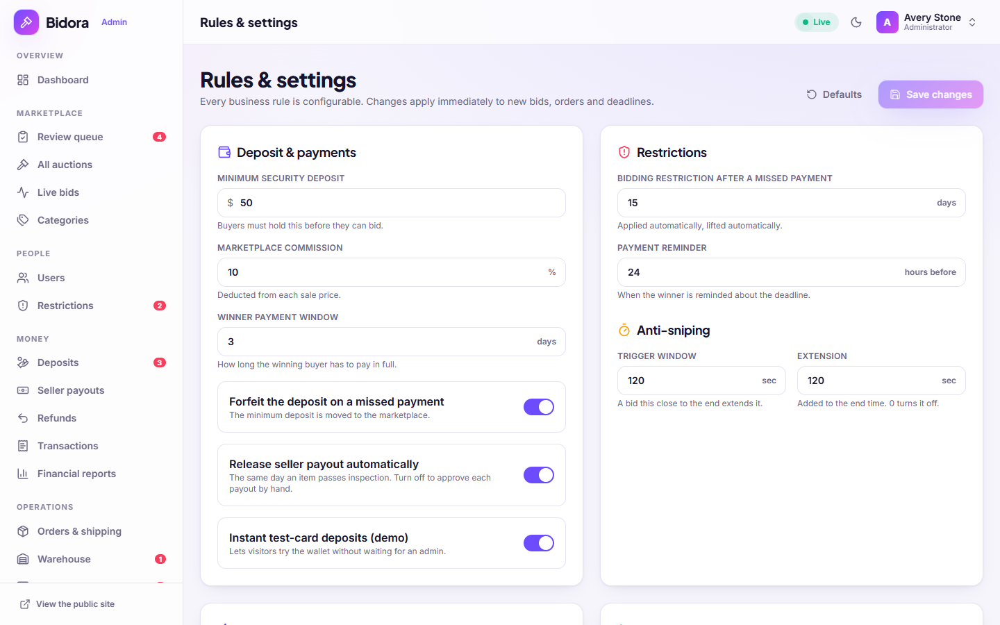 | 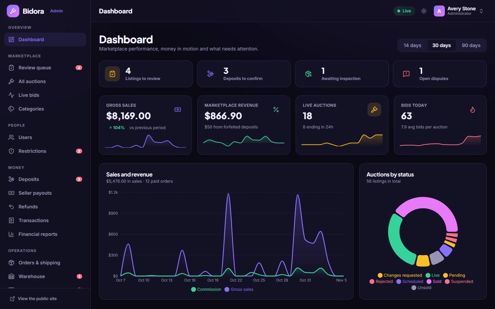 |

The whole interface is responsive and has a light and a dark theme:

 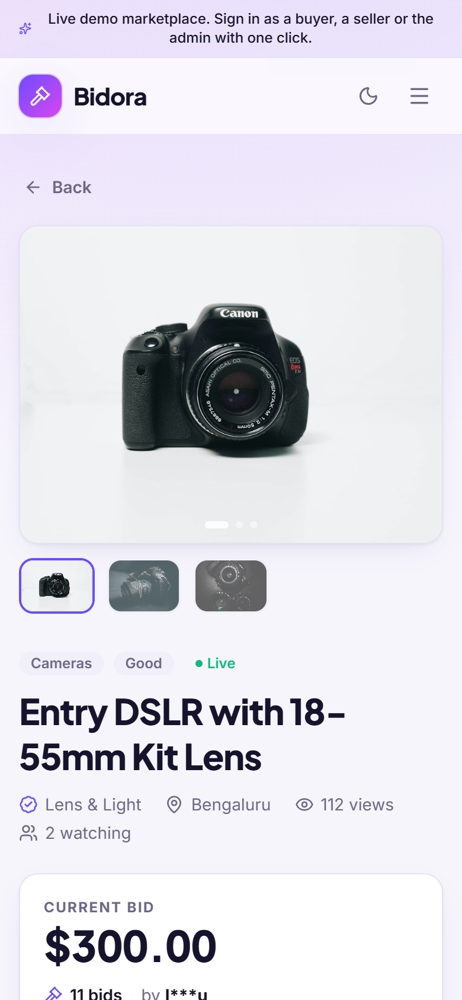

## How it is built

- **Backend:** Node.js 22, Express, Socket.IO for live updates, SQLite (better-sqlite3), zod validation
- **Frontend:** React, Vite, Tailwind CSS, Framer Motion, Recharts
- **Bidding consistency:** every bid runs inside one immediate database transaction, so two people bidding at the same moment can never both win. The minimum amount, deposit status, restrictions and timing are checked inside that transaction.
- **Money:** every movement writes a ledger row and updates the cached balances in the same transaction. Balances can always be reproduced from the ledger (a test checks this on the demo data).
- **Automation:** a scheduler starts and closes auctions, sends reminders, enforces payment deadlines and lifts restrictions.
- **Security:** signed HttpOnly session cookies, role-based access on every API route, rate limiting, strict security headers, upload type and size checks, input validation on every request.
- **Notifications:** in-app and an e-mail outbox (the demo logs e-mails instead of sending them; viewing and editing templates is part of the admin panel).

```
server/   Express API, Socket.IO, scheduler, ledger, seed data and tests
web/      React application (storefront, buyer, seller and admin areas)
docs/     Screenshots
```

## Run it locally

Requires Node.js 22 or newer.

```bash
cd web && npm install && npm run build   # builds into server/public
cd ../server && npm install
node src/index.js                        # http://localhost:8130
```

On first start the database is created and filled with demo data. Copy `.env.example` for the available settings.

### Docker

```bash
docker build -t bidora .
docker run -p 8130:8130 -v bidora-data:/data -e SESSION_SECRET=change-me bidora
```

### Tests

```bash
cd server && npm test
```

31 tests cover the bidding rules, anti-sniping, deposit gating, closing and reserve prices, the full payment and payout flow, failed inspections and refunds, disputes, the payment deadline with deposit forfeiture and the 15-day restriction (including its automatic lift), configurable rules, privacy between buyers and sellers, role-based access and the ledger.

## Notes

- All members, items and money in the demo are made up. Product photos are from [Unsplash](https://unsplash.com).
- The demo wallet uses a sandbox "test card" so visitors can try deposits instantly. Bank-transfer deposits go through the admin's approval queue as in a real deployment.
- Payment gateways, SMS and real e-mail delivery plug into the existing wallet and notification layers.
